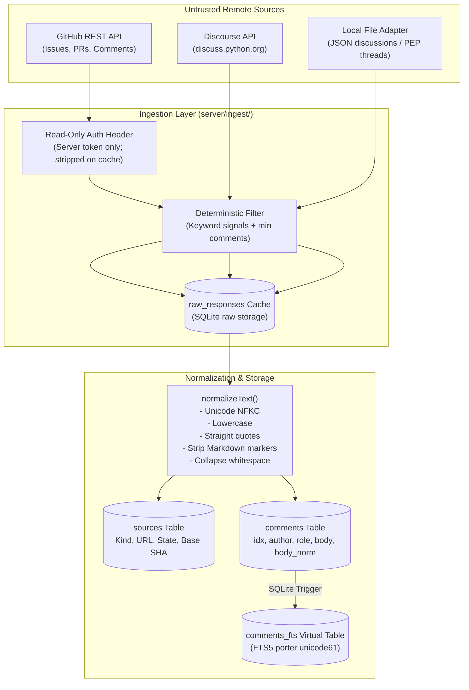
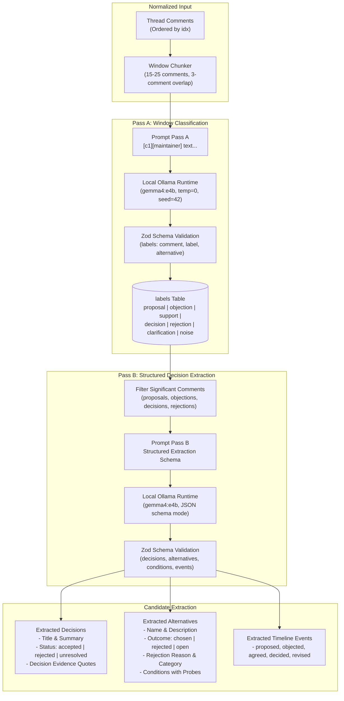
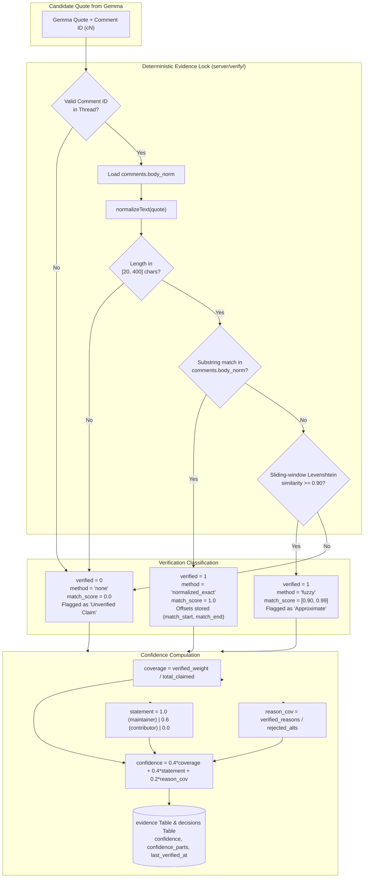
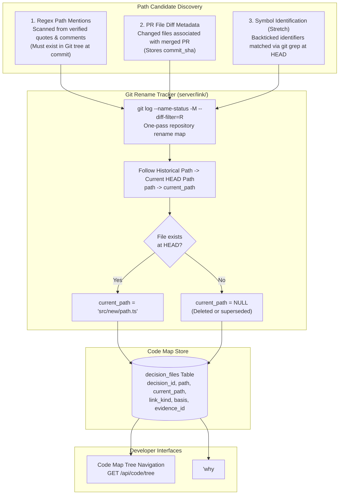
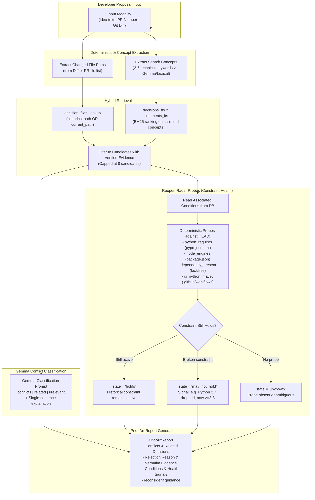

# DecisionVault — Architecture Diagrams

This document illustrates the technical architecture and pipeline flows of DecisionVault, strictly aligned with [`DecisionVault_Architecture_v3.md`](../DecisionVault_Architecture_v3.md).

---

## 1. GitHub Discussion Ingestion Flow

The ingestion pipeline fetches discussions from public repositories and issue trackers, caches raw payloads for reproducible offline processing, and normalizes text for deterministic search and evidence verification.

---

## 2. Gemma Extraction Pipeline

Decision extraction uses a two-pass architecture with Google's **Gemma 4 E4B** (`gemma4:e4b`) running locally via Ollama. Thread comments are assigned anonymized thread-local identifiers (`c1`..`cN`) so Gemma never encounters or fabricates database primary keys or external URLs.

---

## 3. Evidence Lock Verification Flow

The **Evidence Lock** is a 100% deterministic verification module. It enforces that every decision claim and rejection reason extracted by Gemma maps directly to verbatim historical text. Quotes that fail verification cannot contribute to decision confidence.

---

## 4. Decision-to-Code Connection Pipeline

DecisionVault connects recovered decisions to repository source code using a deterministic priority hierarchy. It inspects verified text and PR metadata, tracking Git file renames across time so decisions remain accessible even after files are moved or refactored.

---

## 5. Prior-Decision Warning Flow (Prior Art & Reopen Radar)

DecisionVault prevents relitigation through two complementary feedback mechanisms: **Prior Art Reports** (which warn developers before repeating rejected proposals) and **Reopen Radar** (which alerts maintainers when historical constraints no longer apply).

